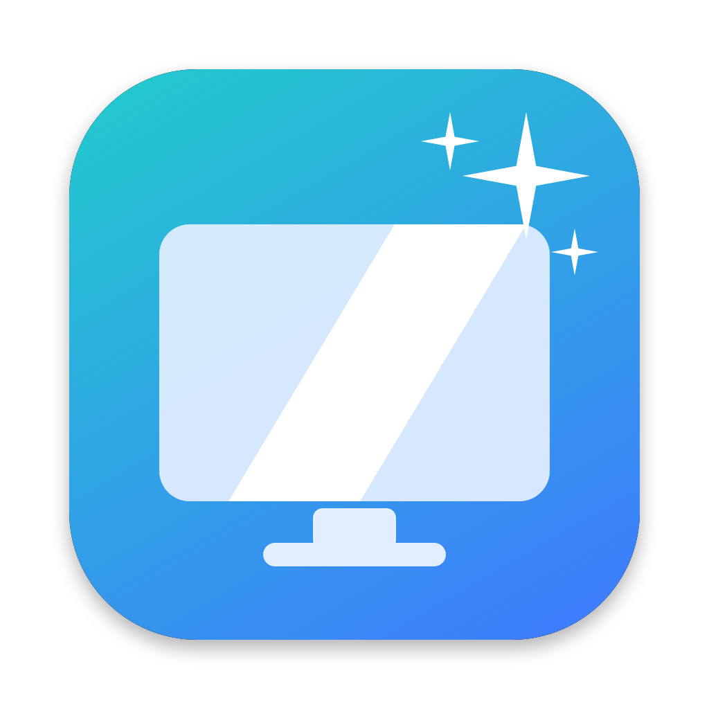
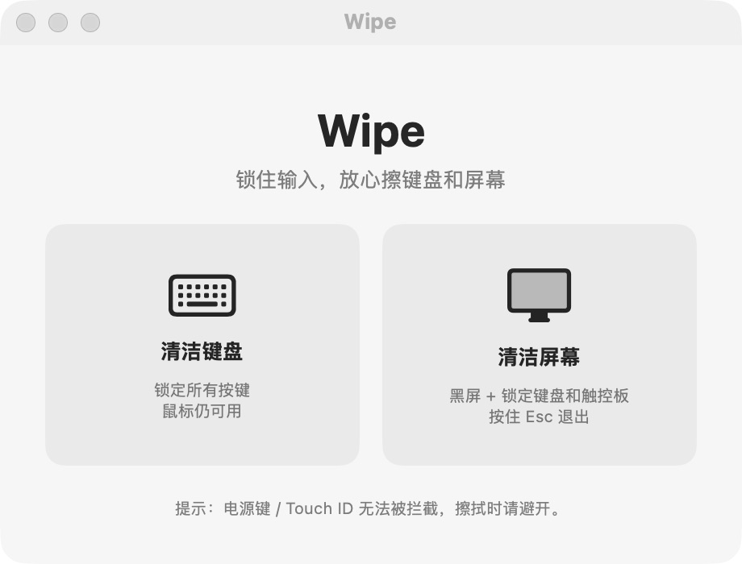
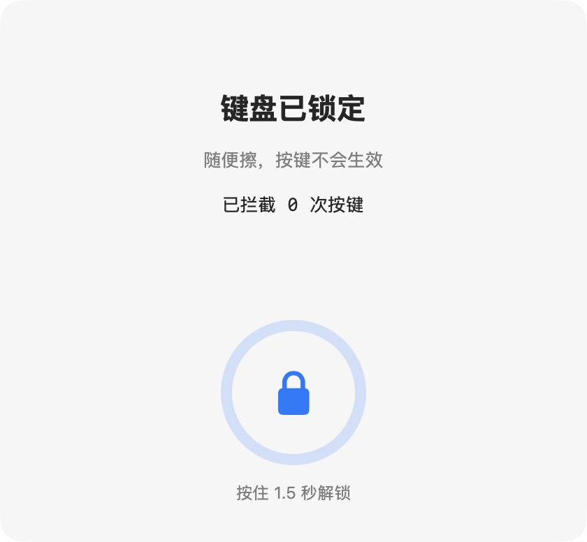

<div align="center">
  
  <h1>Wipe</h1>
  <p><strong>简体中文</strong> · <a href="README.en.md">English</a></p>
  <p><strong>锁住输入，放心擦键盘和屏幕。</strong></p>
  <p>一个为 Mac 日常清洁准备的原生菜单栏小工具。</p>
  <p>
    <a href="https://github.com/FranckStone/wipe/releases/latest"></a>
    
    
    <a href="LICENSE"></a>
  </p>
  <p>
    <a href="https://github.com/FranckStone/wipe/releases/latest"><strong>下载 Wipe</strong></a> ·
    <a href="#使用方法">使用方法</a> ·
    <a href="#从源码构建">从源码构建</a> ·
    <a href="CHANGELOG.md">更新记录</a> ·
    <a href="https://github.com/FranckStone/wipe/issues">反馈问题</a>
  </p>
</div>

---

擦键盘时，不想把一串乱码敲进正在编辑的文档；擦屏幕时，也不想误点窗口或触发触控板手势。打开 Wipe，选择清洁模式，结束后长按解锁，就能继续工作。

Wipe 使用 **SwiftUI + AppKit** 编写，没有第三方包依赖，无需账号，所有输入处理都在本机完成。

## 界面预览

<table>
  <tr>
    <th>主窗口</th>
    <th>键盘清洁模式</th>
  </tr>
  <tr>
    <td valign="top"></td>
    <td valign="top"></td>
  </tr>
</table>

以上为 macOS 上实际运行的应用截图，界面当前使用中文。

## 两种模式，按需选择

| | 清洁键盘 | 清洁屏幕 |
| :--- | :--- | :--- |
| 适合场景 | 擦拭键帽、清理键盘表面 | 擦拭屏幕，或同时清洁键盘和触控板 |
| 键盘与媒体按键 | 拦截 | 拦截 |
| 鼠标与触控板 | 保持可用，方便操作解锁按钮 | 拦截点击、移动、滚动及触控板手势 |
| 屏幕显示 | 浮动解锁面板，显示已拦截按键次数 | 全屏黑色或白色背景，覆盖所有显示器 |
| 退出方式 | 用鼠标或触控板按住解锁按钮 **1.5 秒** | 按住 **Esc 1.5 秒**，或等待 **120 秒**自动解锁 |

- **菜单栏常驻**：关闭主窗口后，仍可从菜单栏开始清洁、重新打开窗口或退出应用。
- **黑白背景切换**：屏幕模式下按空格切换背景，方便查看不同背景下的污渍。
- **长按确认退出**：解锁时显示进度环，减少清洁过程中的误触。

> 电源键和 Touch ID 无法被拦截，擦拭时请避开。清洁模式仅用于临时防止误触，不提供身份验证或系统安全锁屏能力。

## 下载与安装

**系统要求：macOS 13.0 或更高版本；当前预编译安装包适用于 Apple Silicon（arm64）。**

前往 [最新版本](https://github.com/FranckStone/wipe/releases/latest) 下载，或直接获取 v1.0.1：

| 文件 | 用途 |
| :--- | :--- |
| [Wipe-1.0.1-arm64.dmg](https://github.com/FranckStone/wipe/releases/download/v1.0.1/Wipe-1.0.1-arm64.dmg) | 推荐。打开后将 Wipe 拖入 Applications |
| [Wipe-1.0.1-arm64.zip](https://github.com/FranckStone/wipe/releases/download/v1.0.1/Wipe-1.0.1-arm64.zip) | 解压后将 `Wipe.app` 移入 Applications |
| [SHA256SUMS.txt](https://github.com/FranckStone/wipe/releases/download/v1.0.1/SHA256SUMS.txt) | 校验下载文件是否完整 |

### 首次打开

1. 将 Wipe 移入「应用程序」，再打开应用。
2. 在主窗口点击「请求权限」或「打开系统设置」。
3. 前往「系统设置 → 隐私与安全性 → 辅助功能」，开启 Wipe 的权限。若列表中没有 Wipe，可手动添加 `/Applications/Wipe.app`。
4. 返回 Wipe，等待模式按钮可用后开始清洁。

**关于 macOS 的打开提示：** 当前安装包采用 ad-hoc 签名，尚未经过 Apple 公证。如果 macOS 提示无法验证开发者，确认安装包来自本仓库后，可在尝试打开应用后前往「系统设置 → 隐私与安全性」，点击「仍要打开」。具体步骤见 [Apple 官方说明](https://support.apple.com/zh-cn/102445)。

### 校验安装包

将 `SHA256SUMS.txt` 和两个安装包下载到同一目录，在该目录运行：

```sh
shasum -a 256 -c SHA256SUMS.txt
```

两个文件均显示 `OK` 即表示校验通过。只下载了其中一个安装包时，可运行 `shasum -a 256 <安装包文件名>`，与校验文件中的对应值比较。

## 使用方法

### 清洁键盘

1. 在主窗口或菜单栏选择「清洁键盘」。
2. 看到「键盘已锁定」后开始擦拭；面板会显示拦截的按键次数。
3. 清洁结束，用鼠标或触控板**按住面板上的锁形按钮 1.5 秒**，等待进度环完成。

键盘模式保留鼠标与触控板操作，**没有自动解锁倒计时**。此模式下 Esc 也会被拦截，请使用面板按钮解锁。

### 清洁屏幕

1. 在主窗口或菜单栏选择「清洁屏幕」。
2. 所有显示器会覆盖黑色背景，鼠标指针隐藏，键盘、鼠标与触控板输入被拦截。
3. 如需白色背景，按一次**空格**；再次按下切回黑色。
4. 清洁结束，**持续按住 Esc 1.5 秒**退出。提前松开会取消解锁，也可等待 **120 秒**倒计时结束自动恢复。

屏幕模式下，操作提示会在约 3 秒后淡出，底部保留自动解锁倒计时。黑色背景是应用显示的覆盖层，显示器仍保持开启。

## 权限与隐私

Wipe 需要「辅助功能」权限，通过 macOS 的 `CGEventTap` 在清洁期间拦截全局输入；退出清洁模式时会停止拦截。

- **不记录按键内容**：键盘模式只在内存中统计拦截次数，重新开始清洁时清零。
- **不上传输入数据**：当前应用不包含网络请求、遥测或分析服务代码。
- **无需注册与登录**：没有账号、云端同步或后台自动更新服务。

输入处理的实现可直接查看 [InputBlocker.swift](Sources/Wipe/InputBlocker.swift) 和 [CleanController.swift](Sources/Wipe/CleanController.swift)。

## 常见问题

### 为什么清洁按钮不可用？

先检查「系统设置 → 隐私与安全性 → 辅助功能」是否已为 Wipe 开启权限，再返回应用。如果授权后仍不可用，退出并重新打开 Wipe，然后重新检查授权。

### 更新或重新构建后，授权为什么失效？

替换应用或签名变化可能导致系统要求重新授权。可先退出 Wipe，在辅助功能列表中移除旧条目，再添加「应用程序」中的新版 Wipe。源码构建时也可以使用自己的固定签名证书。

### 关掉主窗口后，怎么重新打开？

点击菜单栏的 Wipe 图标，选择「打开 Wipe 窗口」。如需完全退出，选择菜单栏中的「退出 Wipe」。

### 支持 Intel Mac 吗？

目前发布并验证的安装包仅面向 Apple Silicon。构建脚本支持 `ARCH=x86_64`，但尚未提供经过 Intel 真机验证的安装包。

### 可以只关闭显示器或代替系统锁屏吗？

屏幕模式会显示全屏背景并拦截输入，不会关闭显示器，也不会启用 macOS 的身份验证锁屏。需要保护离开电脑后的访问权限时，请使用系统锁屏。

## 从源码构建

需要 macOS、**Swift 5.9 或更高版本**，以及 Xcode 或 Xcode Command Line Tools。项目使用 Swift Package Manager 管理，不需要安装第三方依赖。

```sh
git clone https://github.com/FranckStone/wipe.git
cd wipe
./build.sh
open build/Wipe.app
```

构建产物位于 `build/Wipe.app`，默认编译当前机器架构，使用 ad-hoc 签名，无需开发者证书。

如果希望构建后直接安装并打开：

```sh
./build.sh --install
```

此命令会关闭正在运行的 Wipe，并**替换 `/Applications/Wipe.app`**。

### 构建选项

| 配置 | 默认值 | 说明 |
| :--- | :--- | :--- |
| `VERSION` 文件 | 当前仓库版本 | 应用版本号，格式为 `x.y.z` |
| `BUILD_NUMBER` | `2` | 内部构建号，可通过环境变量覆盖 |
| `ARCH` | 当前机器架构 | 支持 `arm64` 或 `x86_64` |
| `SIGN_IDENTITY` | `-` | ad-hoc 签名；可设置为本机代码签名证书名称或标识 |

例如，指定架构、内部构建号和自己的签名证书：

```sh
ARCH=arm64 BUILD_NUMBER=3 SIGN_IDENTITY="你的代码签名证书名称" ./build.sh
```

### 项目结构

```text
Sources/Wipe/
├── WipeApp.swift          # 应用入口、菜单栏与退出清理
├── Views.swift            # 主窗口、解锁面板与屏幕覆盖层
├── CleanController.swift  # 模式切换、权限、倒计时与退出控制
└── InputBlocker.swift     # 全局输入事件拦截
Resources/                 # 应用图标
scripts/
├── make_icon.swift        # 图标生成工具
└── package_release.sh     # DMG、ZIP 与 SHA-256 打包
build.sh                   # 构建、签名与可选安装
VERSION                    # 应用版本号
```

### 打包安装文件

```sh
./scripts/package_release.sh
```

脚本会先构建并验证应用签名，再将以下文件输出到 `build/release/`：

```text
Wipe-<版本>-<架构>.dmg
Wipe-<版本>-<架构>.zip
SHA256SUMS.txt
```

DMG 包含应用、指向 Applications 的快捷方式和许可证；ZIP 中的应用包也附带许可证。脚本会生成并检查 SHA-256 校验值，**不会执行 Apple 公证或上传 GitHub Release**。

## 反馈与贡献

欢迎提交 [Issue](https://github.com/FranckStone/wipe/issues) 或 [Pull Request](https://github.com/FranckStone/wipe/pulls)。

反馈问题时，请附上 macOS 版本、芯片架构、Wipe 版本、使用的清洁模式和复现步骤；涉及权限时，可补充辅助功能授权状态。

修改输入拦截或退出逻辑后，请在已授权的 Mac 上验证键盘解锁、Esc 长按退出、120 秒自动解锁和应用退出时的输入恢复。涉及多显示器时，也请检查所有屏幕上的覆盖层。

## 许可证

Wipe 的源码和仓库内图标采用 [MIT License](LICENSE) 开源。欢迎使用、修改和分发，请保留原许可证及版权声明。
